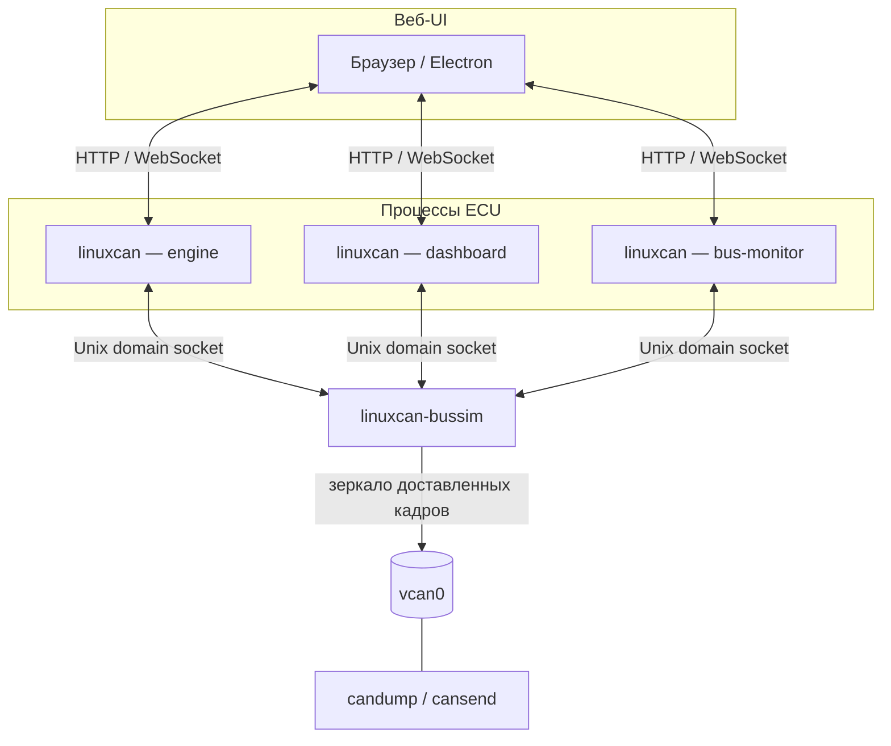

# CANSIM

[](https://github.com/two-lifes/CANSIM/actions/workflows/build.yml)

Битовый симулятор CAN-сети на C++ с веб-интерфейсом: отдельный процесс на каждое ECU,
общая шина через демон `linuxcan-bussim`, зеркалирование в `vcan0` для `candump` / `cansend`.

## Возможности

- Арбитраж CAN по wired-AND на уровне битов
- CRC-15, bit stuffing, ACK и детекция ошибок (stuff / CRC / ACK / bit)
- Счётчики TEC/REC и переходы active → passive → bus-off
- Каждое ECU — отдельный процесс со своим CAN-контроллером
- Демон шины `linuxcan-bussim` и зеркало успешно доставленных кадров в `vcan0`
- Веб-UI для ECU, датчиков и монитора шины; опционально окна Electron

## Требования

| Компонент | Версия / примечание |
|-----------|---------------------|
| ОС | Linux с SocketCAN (виртуальный интерфейс `vcan0`) |
| Компилятор | C++17 (`CMAKE_CXX_STANDARD 17` в `CMakeLists.txt`) |
| CMake | ≥ 3.16 (`cmake_minimum_required` в `CMakeLists.txt`) |
| can-utils | `candump`, `cansend` (проверка шины и ручные кадры) |
| Node.js | для Electron UI (`electron` ^35.0.0 в `electron/package.json`) |

## Скриншоты

Монитор шины:


Страница ECU:


## Архитектура



## Сборка

```bash
cmake -B build -DCMAKE_BUILD_TYPE=Release
cmake --build build -j
```

Скрипт `./linuxcan` перед запуском сети сам пересобирает проект при необходимости.

## Запуск

```bash
chmod +x linuxcan scripts/setup-vcan.sh

# виртуальная шина (один раз, sudo)
./scripts/setup-vcan.sh

# все ECU из ecus/*/ecu.json
./linuxcan

# статус / остановка
./linuxcan status
./linuxcan stop
```

UI в браузере:

- адреса печатаются в терминале после `./linuxcan`
- монитор шины: http://127.0.0.1:8750/bus.html
- примеры из репозитория:
  - http://127.0.0.1:8765/ecu.html — engine
  - http://127.0.0.1:8766/ecu.html — dashboard
  - http://127.0.0.1:8767/ecu.html — dashboard2
  - http://127.0.0.1:8768/ecu.html — engine2

Один ECU:

```bash
./linuxcan --ecu-id engine --port 8765 --page ecu.html --config-dir ecus/engine --open
```

Electron (отдельные окна):

```bash
./linuxcan
cd electron && npm install && npm start
```

Остановка: **Ctrl+C** в терминале с `./linuxcan` или `./linuxcan stop` из другого терминала.

## Тесты

Смотреть шину (отдельный терминал):

```bash
candump vcan0
```

Отправить кадр вручную:

```bash
cansend vcan0 100#DEADBEEF12345678
```

Проверить интерфейс:

```bash
ip link show vcan0
```

Сценарий UI (ECU, датчики, формула, TX на CAN):

1. `./linuxcan` и в другом терминале `candump vcan0`
2. Открыть любой ECU из списка в терминале
3. В каталоге слева выбрать датчик (двойной клик или «Добавить»)
4. Подключённый датчик — карточка, его выход идёт линией на вход ECU (a, b, c…)
5. Сверху ECU: «Вычислено» (формула) и «На CAN (TX value)»
6. В `candump` — кадры на CAN ID из TX-блока ECU

## Документация

- Новое ECU: [docs/ECUS.md](docs/ECUS.md)
- Новый тип датчика: [docs/SENSORS.md](docs/SENSORS.md)
- Зеркало `vcan0` и реальная шина: [docs/REAL_BUS.md](docs/REAL_BUS.md)
- Битовый CAN (арбитраж, CRC, stuffing, ACK, TEC/REC, bus-off): [docs/CAN_PROTOCOL.md](docs/CAN_PROTOCOL.md)
- Архитектура: [docs/ARCHITECTURE.md](docs/ARCHITECTURE.md)
